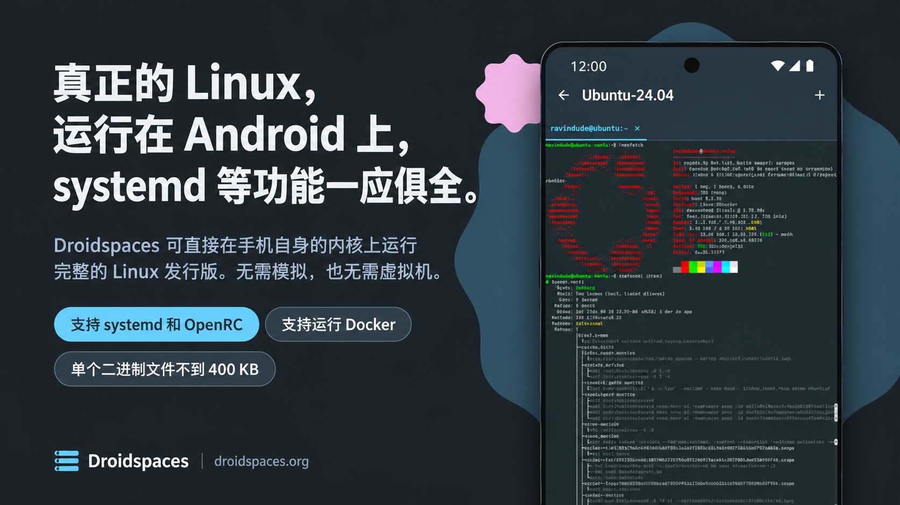

[English](../../README.md) | 简体中文

# Droidspaces

Droidspaces 在已 root 的 Android 手机或 Linux PC 上，以容器方式运行完整的 Linux 发行版。每个容器都在宿主机内核上启动自己的 init 系统，无论是 systemd、OpenRC 还是其他。

**这并非模拟器，也不是虚拟机**，程序以原生速度运行。所有功能都由一个不到 400 KB 的静态二进制完成，Android 应用则负责驱动它，让你无需终端即可上手。

## 你能得到什么

- **真正的 Linux 系统，不是 chroot，也不是虚拟机：** Ubuntu、Debian、Fedora、Arch、Alpine、NixOS、OpenWrt 等发行版都以自己的 init 作为 PID 1 启动。服务、定时器、在容器内执行 `reboot`，一切都能正常工作。
- **开箱即用的网络：** NAT 模式让每个容器无需任何配置就拥有自己的地址和互联网访问。网关模式把容器的 LAN 交给一个 OpenWrt 容器，由它负责 DHCP、DNS 和防火墙。Macvlan 则让容器直接接入有线局域网，从路由器获取自己的地址。
- **运行在手机上的桌面环境：** 显示用 Anland 或 Termux:X11，GPU 用 VirGL 或高通的 Turnip，声音用 PulseAudio，全部自动启动。打开开关、启动容器，桌面环境就会带着声音出现。
- **需要时能访问硬件：** GPU、USB、传感器和块设备都可以通过一个开关暴露给容器。Docker 和 Podman 能在所有受支持内核上的容器内运行。
- **长期运行的容器：** 在 Android 上，容器可以在开机时启动，早于你解锁手机，并且**持续运行数月**，无论应用是打开、关闭还是已卸载。一切都存放在 `/data/local/Droidspaces`。
- **Linux 上是同一个二进制：** CLI 的每个功能在 Linux PC 上表现一致。软件包构建涵盖 aarch64、armhf、x86_64、x86 和 riscv64。

## 系统要求

**Android**

- 已 root 的设备。**推荐 KernelSU**，Magisk 和 APatch 也可以。
- 内核需启用 Droidspaces 所需的选项。多数原厂内核都没有。参见[内核配置指南](Kernel-Configuration.md)，或从[社区支持的设备](community-supported-devices.md)列表中挑选手机，该列表会链接到现成的内核。
- 内核 3.10 或更新。4.9 及以上是大多数发行版工作良好的版本。

**Linux**

- 内核 3.10 或更新，并具备 root 权限。任何当前的主流桌面发行版都已具备其余条件。运行 `sudo ./droidspaces check` 确认。

## 快速开始

**Android**

1. 从[最新发行版](https://github.com/ravindu644/Droidspaces-OSS/releases/latest)安装 APK，授予 root 权限，打开应用，让它安装后端。它提示时重启。
2. 打开 **容器** 标签页，点击 **+**，再点 **仓库**。选择一个发行版，点 **下载**，再点 **安装**，然后按向导完成设置。
3. 点击 **启动**。打开 **面板** 标签页，点 **终端** 即可获得一个 shell。

[Android 安装指南](Installation-Android.md)详细介绍了每一步。

**Linux**

[Linux 安装指南](Installation-Linux.md)介绍如何安装 Droidspaces、从哪里获取 rootfs，以及如何把它放进镜像文件。

## 截图

<table>
  <tr>
    <td width="33%" align="center"> 首页</td>
    <td width="33%" align="center"> 容器</td>
    <td width="33%" align="center"> 面板</td>
  </tr>
</table>

## 安全

> [!WARNING]
>
> Droidspaces 是一个特权容器。
>
> 容器内的 root 权限很强大，恶意的 root 进程可以触达宿主机。
>
> 不要在容器中运行你不信任的代码，日常操作请像在任何 Linux 机器上一样，使用普通用户配合 `sudo`。
>
> 硬件访问和特权模式会进一步放宽剩余的防护，因此只在需要时开启。

## 文档

以下所有内容也在[文档站点](https://www.droidspaces.org/docs/)上，可直接阅读和搜索。

| 页面 | 内容 |
|------|------|
| [Android 安装](Installation-Android.md) | 从已 root 的手机，到在应用里跑起一个容器。 |
| [Linux 安装](Installation-Linux.md) | 在 PC 上安装二进制并准备 rootfs。 |
| [Android 应用指南](Usage-Android-App.md) | 应用中的每个界面及其作用。 |
| [容器设置](Features.md) | 每个开关和参数：做什么，什么时候用。 |
| [Linux CLI](Linux-CLI.md) | 每条命令、参数和配置文件键。 |
| [从零开始的网络基础](Networking-From-Zero.md) | 网络模式如何工作，从 IP 地址一直讲到 OpenWrt 网关。 |
| [显示、音频与桌面](Graphics-and-Audio.md) | Android 和 Linux 上的 GPU 加速、声音与桌面环境。 |
| [Anland](Anland.md) | 通过 Anland 应用在 Android 上运行 Wayland 桌面，适用于 KDE Plasma 等 Wayland 合成器。 |
| [内核配置](Kernel-Configuration.md) | 构建支持 Droidspaces 的 Android 内核。 |
| [实用配方](Cool-things-you-can-do.md) | 用 Tailscale 把手机变成家庭服务器、在容器里跑 Docker，以及更多。 |
| [故障排查](Troubleshooting.md) | 症状、原因和解决办法。 |
| [社区支持的设备](community-supported-devices.md) | 已知可运行 Droidspaces 的手机及其内核源码。 |
| [NixOS](Nix-NixOS.md) | 构建并配置 NixOS 容器。 |
| [卸载](Uninstallation.md) | 从 Android 或 Linux 上移除 Droidspaces。 |

## 社区与贡献

提问和求助：[Telegram 频道](https://t.me/Droidspaces)。Bug 和功能请求：[GitHub issues](https://github.com/ravindu644/Droidspaces-OSS/issues)。

代码贡献请先阅读 [CONTRIBUTING.md](./CONTRIBUTING.md)。应用翻译在 Weblate 上：

## 致谢

- [LXC](https://github.com/lxc/lxc)，架构上的灵感来源。
- [BusyBox](https://busybox.net/)，应用用于解压和初始化的静态二进制（[我们的构建](https://github.com/Droidspaces/busybox-droidspaces)）。
- [ReTerminal](https://github.com/RohitKushvaha01/ReTerminal)、[Termux](https://github.com/termux/termux-app) 和 [LXC-Manager](https://github.com/Container-On-Android/LXC-Manager)，终端模拟器后端。
- [JetBrains Mono](https://www.jetbrains.com/legalforms/fonts/)，应用中的等宽字体，遵循 [SIL Open Font License 1.1](https://scripts.sil.org/OFL)。

## 许可证

[GNU General Public License v3.0](../../LICENSE)。版权所有 (C) 2026 [ravindu644](https://github.com/ravindu644) 及贡献者。
